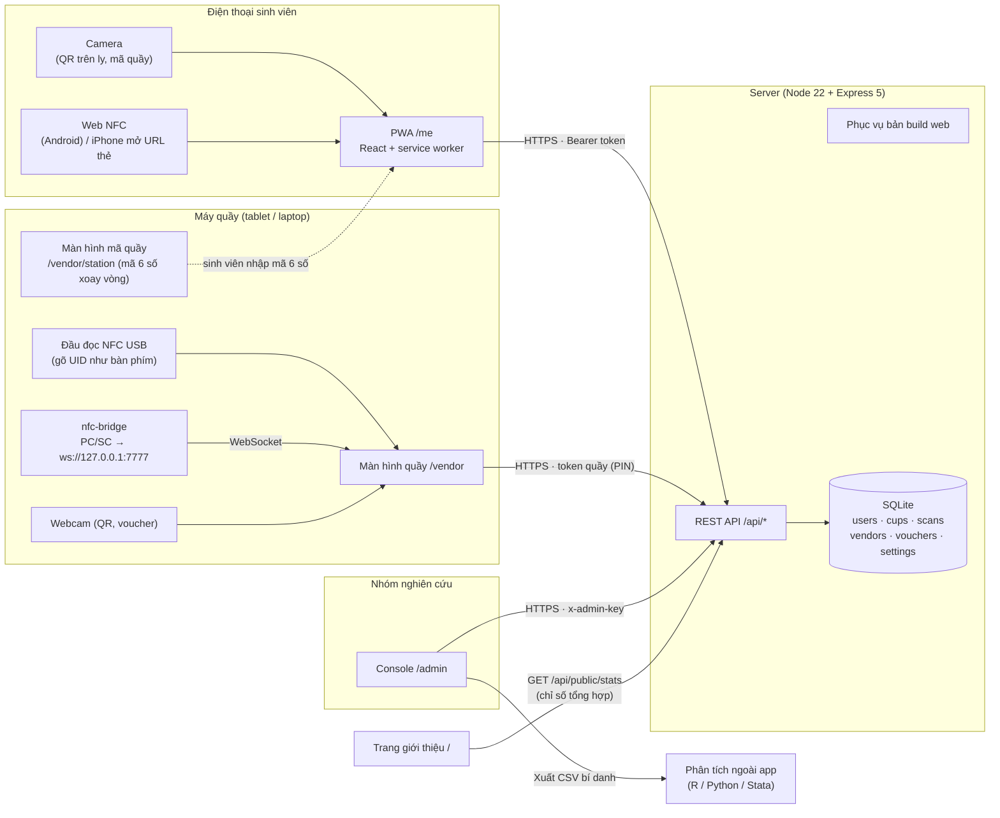
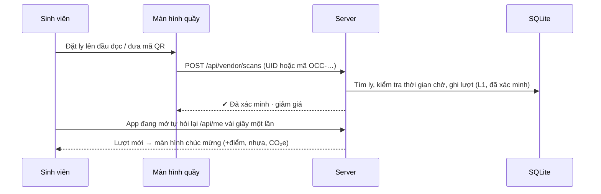

# Kiến trúc & tech stack

## Tech stack

| Lớp | Công nghệ | Ghi chú |
|---|---|---|
| Giao diện | **React 19**, TypeScript, **Vite 8**, `react-router-dom` 7 | Một app web duy nhất cho 4 phần: trang giới thiệu `/`, sinh viên `/me`, quầy `/vendor`, console `/admin` |
| Cài như app | **PWA** (`vite-plugin-pwa`, service worker Workbox) | Không cần app store; thêm vào màn hình chính, mở thẳng `/me` |
| Ngôn ngữ | i18n tự viết, có kiểu (`web/src/i18n/vi.ts`, `en.ts`) | Tiếng Việt / English, định dạng số & ngày theo `vi-VN` / `en-GB` |
| Quét QR | `qr-scanner` (camera trình duyệt), `qrcode` (in mã) | Cần HTTPS hoặc `localhost` để mở camera |
| Quét NFC | **Web NFC** (Chrome Android) · đầu đọc **USB dạng bàn phím** · **cầu PC/SC** (`nfc-bridge`) | Thẻ NTAG215; UID 7 byte, đầu đọc USB gửi 4 byte đầu (số thập phân) |
| Giao diện phụ | `lucide-react` (icon), font Nunito, biểu đồ SVG tự vẽ | Linh vật, nút 3D theo bộ thiết kế |
| Máy chủ | **Node.js ≥ 22.6** + **Express 5**, TypeScript chạy trực tiếp (`--experimental-strip-types`) | Một tiến trình phục vụ cả API lẫn bản build web |
| Cơ sở dữ liệu | **SQLite** qua `node:sqlite` (có sẵn trong Node) | Một tệp `.sqlite`; migration theo `PRAGMA user_version` |
| Cầu NFC | `nfc-bridge/`: Node + `nfc-pcsc` + `ws` | Chạy trên máy quầy, chỉ lắng nghe `127.0.0.1:7777` |
| Kiểm thử | `node:test` (26 test API & domain), Playwright (chụp màn hình) | `npm test`, `npm run build` |
| Xuất dữ liệu | CSV bí danh (nghiên cứu, dataset mở, quầy theo ngày) | Phân tích thống kê (ITS, hồi quy) làm ngoài app |

## Sơ đồ kết nối hệ thống

## Một lượt dùng ly đi qua hệ thống

Ba mức ghi nhận: **L1** nhân viên quét tại quầy và **L2** sinh viên nhập mã quầy 6 số đều *đã xác minh*;
**L3** tự quét bị giới hạn tần suất và đánh dấu *chưa xác minh*. Chỉ L1–L2 vào phân tích.

## Triển khai

- Một server: `npm run build` rồi `npm start` (cổng `PORT`, tệp dữ liệu `DB_PATH`). Server phục vụ luôn web.
- Camera và Web NFC cần HTTPS: đặt server sau reverse proxy có chứng chỉ (Caddy, nginx) hoặc dùng `HTTPS=1 npm run dev:web` khi thử trong mạng LAN.
- Máy quầy chỉ cần trình duyệt; `nfc-bridge` chỉ dùng với đầu đọc PC/SC (ACR122U…). Đầu đọc USB dạng bàn phím không cần cài gì.
- Sao lưu: chép tệp `.sqlite` định kỳ.
